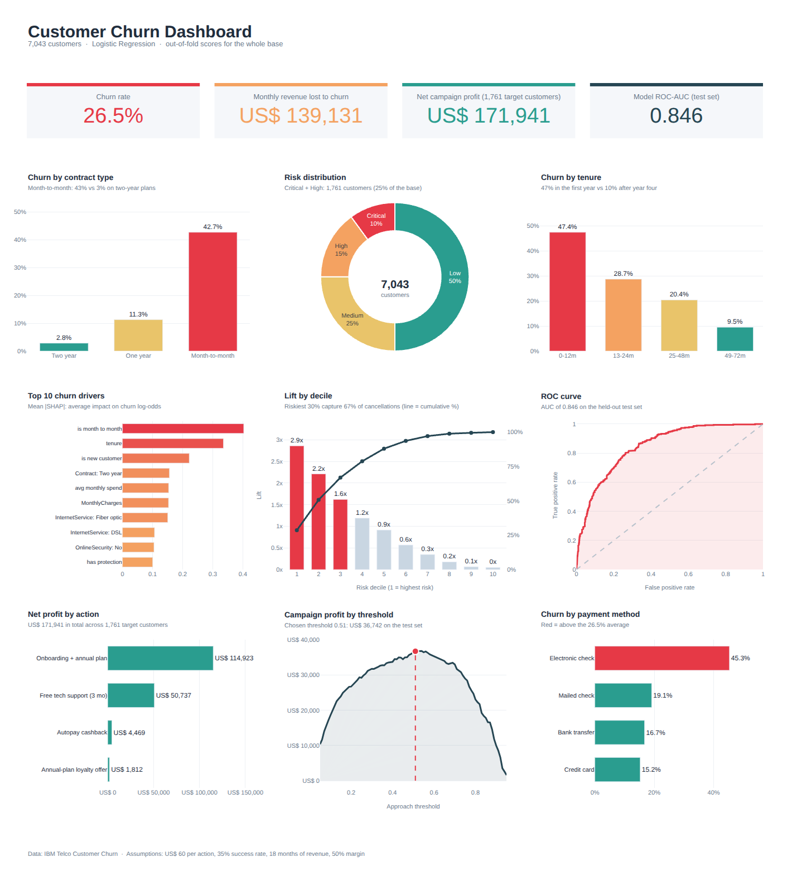

# Customer churn prediction

Which telecom customers are likely to cancel, why, and is it worth trying to keep them?

The notebook uses the [IBM Telco Customer Churn](https://github.com/IBM/telco-customer-churn-on-icp4d) dataset (7,043 customers) and a logistic regression model. It goes from exploring the data to a retention plan with estimated costs and returns.

[](https://colab.research.google.com/github/<your-user>/churn-prediction/blob/main/churn_prediction.ipynb)



## What the notebook does

1. Cleans the data and explores who churns (contract type, tenure, payment method...)
2. Creates a few extra features (number of services, price changes, risk flags)
3. Trains a logistic regression with class weights and tunes the regularization with cross-validation
4. Picks the decision threshold by estimated campaign profit instead of using 0.5
5. Explains the model with odds ratios and SHAP values (computed directly, since the model is linear)
6. Splits customers into risk bands and suggests a retention action for each one
7. Builds a dashboard and saves the model and the list of customers at risk

## Results

On the held-out test set (20% of the data):

- ROC-AUC around 0.85 and PR-AUC around 0.66
- The riskiest 10% of customers hold about 29% of all cancellations, and the riskiest 30% hold about 67%

Numbers can vary slightly with library versions. The profit figures depend on assumptions about action cost, success rate and customer value that are set at the top of that section and are only illustrative.

## How to run

**Google Colab:** open the notebook and use `Runtime > Run all`. Everything it needs is already installed there.

**Locally:**

```bash
pip install -r requirements.txt
jupyter notebook churn_prediction.ipynb
```

The dataset is downloaded from GitHub when the notebook runs, so an internet connection is needed. It takes a minute or two.

## Files

```
churn_prediction.ipynb   the analysis
images/dashboard.png     preview of the final dashboard
requirements.txt
```

Running the notebook also creates `churn_model.joblib`, `churn_risk_customers.csv` and `churn_dashboard.html` (interactive version of the dashboard). They are not tracked in Git.

## Limitations

- One public dataset, so the patterns may not hold for another company
- Probabilities are not calibrated because of the class weights, so they are meant for ranking customers
- The profit estimate is a simulation, not a forecast

## License

MIT, see [LICENSE](LICENSE).
